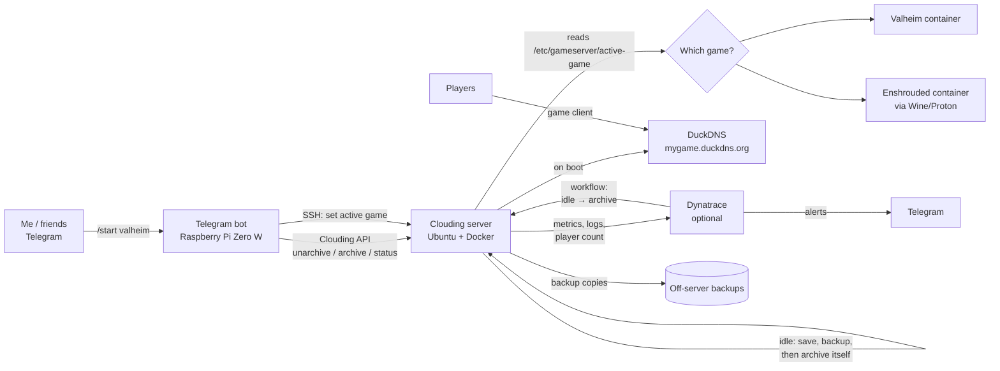

# Project plan

On-demand Valheim and Enshrouded server on Clouding.io, controlled from a Telegram bot on a Raspberry Pi.

## 1. Why

The current Valheim server on Zap (2 GB) crashes. It is billed 24/7, while we play only a few hours a day, and it covers one game only.

| Option | Games | ~Monthly |
|---|---|---|
| Zap, 2 GB (current) | Valheim (crashes) | $8 |
| Zap, 4 GB tier | Valheim | ~$16 |
| Hosted, two servers | Both | ~$30+ |
| GCP (earlier plan) | Both | ~$10–14 |
| **This project (Clouding.io + DuckDNS)** | **Both** | **~€8** |

---

## 2. Architecture



### Components

| Component | Runs on | Purpose | Required? |
|---|---|---|---|
| Telegram bot | Raspberry Pi Zero W (shared with Pi-hole) | Start/stop/switch/status, permissions, long-run warning and hard stop | Yes |
| Game server | Clouding.io, Barcelona: 4 vCPU, 8 GB RAM, 40 GB SSD | Runs one game at a time | Yes |
| Game containers | Docker Compose on the server | One container and data volume per game | Yes |
| Idle checker | systemd timer on the server | Counts players; when idle, saves, backs up, then archives the server through the API | Yes |
| Save-on-shutdown | systemd service on the server | Stops the game cleanly on any shutdown (safety net) | Yes |
| DuckDNS updater | Server boot script | Keeps a fixed hostname pointing at the IP, in case it changes on unarchive | Yes |
| Backups | Server disk + off-server copy | World saves | Yes |
| Dynatrace | SaaS | Monitoring, logs, player history, alerts, faster idle shutdown | **No, add-on** |

### Key decisions

- **Clouding.io instead of GCP or Azure.** About €8/month for both games. Archived servers are billed only for disk (and backups, if enabled), not CPU and RAM.
- **Archive, not power off.** A powered-off server is expected to keep billing for CPU and RAM. Every "stop" in this project means **archive through the Clouding API**.
- **Save before archiving.** Whoever archives (idle checker, bot, Dynatrace) first runs the save-and-backup step, then calls the API. The systemd shutdown service is only a safety net, since it is not confirmed how gracefully Clouding shuts a server down when archiving.
- **No provider-side max run time.** Clouding has no equivalent of GCP's max run duration, so the Pi bot does the hard stop.
- **Active game set over SSH, not metadata.** Clouding has no instance metadata like GCP. The bot writes the game name to `/etc/gameserver/active-game` over SSH with a restricted key that can only run one command.
- **OS: Ubuntu Server LTS.** Headless; servers installed with SteamCMD or prebuilt Docker images.
- **Docker Compose, not Kubernetes.** One server running one container at a time needs no orchestration.
- **Vanilla first, mods later.** 8 GB leaves room for mods; each game keeps its own data volume.

---

## 3. Games

| Game | Server | Ports (UDP) | Notes |
|---|---|---|---|
| Valheim | Native Linux, Docker image | 2456–2458 | Crossplay off |
| Enshrouded | Windows build via Wine/Proton, Docker image | 15636–15637 | Server files ~13 GB, CPU-hungry |

---

## 4. Bot commands

| Command | Who | What it does |
|---|---|---|
| `/start <game>` | Admin, allowlisted friends | Unarchives the server, sets the active game, replies when joinable |
| `/stop` | Admin | Save, backup, archive |
| `/switch <game>` | Admin | Save current game, start the other |
| `/status` | Everyone allowlisted | Server state, game, players, uptime |

The bot stores the Clouding API key and Telegram token in a `.env` file on the Pi (never committed).

---

## 5. Shutdown and safety

| Layer | Trigger | Action |
|---|---|---|
| 1. Dynatrace (optional) | 30 min with no players | Workflow runs save + archive |
| 2. Server idle checker | 60 min with no players | Save, backup, archive itself |
| 3. Pi warning | Server running 6 h | Telegram message to admin |
| 4. Pi hard stop | Server running 8 h | Pi archives the server through the API |
| 5. Spending check | Monthly | Check Clouding balance/billing page (alert option to be confirmed) |

**Grace period:** after boot, the idle checker waits 15 min so the server doesn't archive before anyone joins.

**Idle check logic:**
1. Query player count (Steam A2S query on the game's query port).
2. If 0 players, increase an idle counter; otherwise reset it.
3. When the idle time is over the limit: `docker compose stop` (game saves on exit), run `backup.sh`, call the Clouding API to archive this server.

---

## 6. Backups

- `backup.sh` runs every 30 minutes during play and once before every archive.
- Keeps the last N backups per game on the server disk (the disk is kept while archived).
- Copies each backup off the server so a lost server doesn't lose the worlds. Target to decide: the Pi (always on) or a free-tier object store (e.g. Cloudflare R2, Backblaze B2). Clouding's own paid backups are an alternative.
- Restore is tested in Phase 5.

---

## 7. Cost estimate (Clouding.io, Nov 2026)

Usage: ~100–130 h/month for both games, including boot and idle time.

| Item | Monthly |
|---|---|
| Compute, 4 vCPU + 8 GB (€20/month 24/7 ≈ €0.027/h), ~130 h | ~€3.60 |
| Disk, 40 GB SSD (billed also while archived) | ~€4 |
| Traffic (4 TB included) | €0 |
| DuckDNS | €0 |
| Off-server backups (free tier or Pi) | ~€0 |
| **Total** | **≈ €8** |

If the server runs 24/7 by mistake: about €24/month. That's why the shutdown layers matter.

---

## 8. Repository layout

```
.
├── README.md
├── docs/
│   ├── plan.md               # this file
│   ├── clouding-setup.md     # server, firewall, SSH, API key
│   └── troubleshooting.md
├── bot/                      # runs on the Raspberry Pi
│   ├── bot.py
│   ├── requirements.txt
│   ├── .env.example
│   └── gamebot.service       # systemd unit
├── server/                   # runs on the Clouding server
│   ├── docker-compose.yml    # one service per game
│   ├── boot.sh               # updates DuckDNS, starts the active game
│   ├── idle-check.sh
│   ├── backup.sh
│   ├── archive-self.sh       # save + backup + Clouding API archive
│   └── systemd/
│       ├── gameserver.service        # boot + save-on-shutdown
│       ├── idle-check.service
│       ├── idle-check.timer
│       ├── backup.service
│       └── backup.timer
├── dynatrace/                # optional workflow definitions
└── .gitignore                # .env, keys, saves/
```

**Never commit:** `.env`, Clouding API key, Telegram token, SSH private keys, server passwords, world saves.

---

## 9. Roadmap

Each phase is a GitHub milestone. Progress is tracked there, not in this file (see [section 11](#11-project-tracking)).

| Milestone | Scope | Release |
|---|---|---|
| **Phase 1, manual server** | Clouding server, firewall, SSH hardening, Docker, Valheim (crossplay off), join by IP; test archive/unarchive time, IP and billing | `v0.1` |
| **Phase 2, self-sufficient server** | DuckDNS on boot, backups, idle checker that archives through the API, save-on-shutdown service | `v0.2` |
| **Phase 3, bot** | Telegram bot on the Pi: `/start`, `/stop`, `/status`, roles, 6 h warning, 8 h hard stop | `v0.3` |
| **Phase 4, second game** | Enshrouded container, active-game file over SSH, `/switch` | `v0.4` |
| **Phase 5, reliability** | Off-server backups, migrate the Zap world, restore test | `v1.0` |
| **Phase 6, Dynatrace** | OneAgent, logs, player metric, dashboards, alert and idle-archive workflows | `v1.1` |
| **Later** | Mod support (BepInEx for Valheim) | — |

---

## 10. Decisions log

| Question | Decision |
|---|---|
| Cloud provider | Clouding.io (moved from GCP: cheaper, archive billing) |
| Location | Barcelona (Clouding's only data center) |
| Server size | 4 vCPU, 8 GB RAM, 40 GB SSD |
| Stop method | Archive through the Clouding API, always after save + backup |
| Container runtime | Docker Compose on a single server (no Kubernetes) |
| Game schedule | None; any game, any day. Hours are estimates for cost only |
| Valheim crossplay | Off |
| Mods | None for now; planned later |
| Who can start | Admin and allowlisted friends |
| Who can stop/switch while running | Admin only |
| Fixed address | DuckDNS hostname |
| Active game | File on the server, set by the bot over SSH |
| Bot host | Raspberry Pi Zero W, shared with Pi-hole |
| Monitoring | Dynatrace as an optional add-on |
| Shutdown safety | Dynatrace 30 min → server idle check 60 min → Pi warning 6 h → Pi hard stop 8 h → monthly spending check |

### Still open

- How long unarchiving takes, and whether the public IP changes (test in Phase 1).
- Confirm on the billing page that archived hours charge only for disk.
- Performance on shared vCPUs with real players (lag test in Phase 1).
- Whether Clouding API keys can be limited in scope; the server holds a key to archive itself.
- Off-server backup target: Pi, object storage, or Clouding backups.
- Whether Clouding offers spending alerts.
- Idle timeouts: 30/60 minutes are defaults; adjust after a few sessions.

---

## 11. Project tracking

| Tool | Used for |
|---|---|
| **Milestones** | Roadmap phases, with progress bars |
| **Issues** | Individual tasks and open questions |
| **Project board** | To do / In progress / Done overview |
| **Pull requests** | Every change, linked to an issue |
| **Releases** | A tag at the end of each phase |
| **This plan** | Architecture and the decisions log (the "why") |

**Conventions**
- Labels: `server`, `bot`, `cloud`, `dynatrace`, `docs`, `question`, `bug`.
- One branch and pull request per issue, branch name `<issue-number>-short-name` (e.g. `3-docker-install`).
- Commit or PR description includes `Closes #N`, which closes the issue on merge.
- Open questions are issues with the `question` label; the answer goes in the decisions log.

---

## Acknowledgements

Planned and built with the help of [Claude](https://claude.ai) by Anthropic, used for architecture design, cost analysis and documentation.
